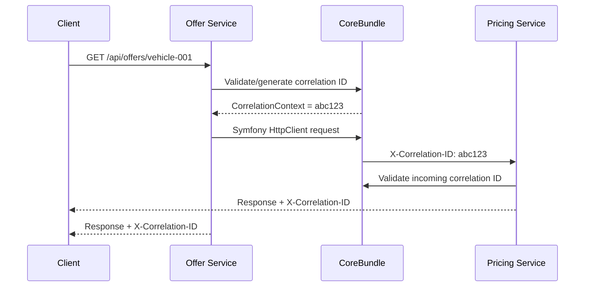

# 13 — Shared CoreBundle: cross-cutting platform capabilities

## 1. Decision and purpose

AutoFlow is a monorepo containing independently deployable Symfony applications. Repeating the same technical plumbing in every service creates drift, but sharing business models would couple bounded contexts and make independent evolution harder.

The accepted approach is a small Symfony bundle at `packages/core-bundle`, distributed locally through Composer path repositories in this monorepo.

**The CoreBundle is a technical foundation, not a shared domain.** It contains stable mechanics that are useful across multiple services. A service may opt into a capability; the bundle must not force every service to adopt every infrastructure technology.

## 2. Implemented in CoreBundle v2

- Symfony bundle class, DependencyInjection extension and validated configuration.
- Correlation ID context with incoming-header validation and safe generation.
- Response echo of `X-Correlation-ID` and outgoing Symfony HttpClient propagation.
- Liveness and readiness routes with fail-closed readiness.
- Tagged readiness-check contract and result object.
- Messenger correlation stamp and middleware with scoped restoration.
- Transport-neutral integration-event envelope with event, aggregate, schema, correlation and causation metadata.
- RFC 9457-style Problem Details response factory.
- Clean Architecture serialization port with JSON and Protobuf adapters.
- RoadRunner HTTP worker bridging PSR-7 requests to the Symfony HttpKernel.
- RoadRunner gRPC server runner and shared `PlatformHealthService/Ping` smoke-test contract.
- HTTP/gRPC status mapping and protocol-safe error types.
- Application clock port with a system implementation.
- Application event-bus port with a Symfony Messenger adapter.
- Idempotency-store and transaction-manager ports; persistence implementations remain service-owned.
- HTTP JSON success-response factory.
- gRPC metadata normalization/allow-listing and deadline validation.

The existing `/health` endpoints remain unchanged because Compose health checks depend on them. The bundle adds `/health/live` and `/health/ready`. Business RPC contracts and generated business adapters remain service-owned.

## 3. Runtime request flow

OpenTelemetry remains responsible for trace/span context propagation through W3C Trace Context. The correlation ID is a separate operational identifier.

## 4. HTTP and gRPC transport flow

RoadRunner owns the process lifecycle and exposes HTTP and gRPC listeners. The HTTP worker converts PSR-7 messages at the outer boundary and invokes the normal Symfony HttpKernel. The gRPC worker registers generated service interfaces and service-owned adapters. The shared `PlatformHealthService/Ping` method verifies gRPC transport startup.

Each gRPC adapter maps a Protobuf request to the same Application command/handler used by REST; it must not reimplement business rules. Generated messages must never enter Domain code. Internal gRPC listeners are not intended to be public endpoints.

Application depends on `SerializerInterface`; Infrastructure provides JSON and Protobuf codecs. The Protobuf decoder requires an explicit generated message class and must never instantiate a class name taken from an untrusted payload.

`(new GrpcMetadata())->allowListed()` supports explicit propagation of safe operational metadata. It does not forward credentials implicitly. `GrpcDeadline` represents a validated positive finite timeout; a service-owned client adapter converts it to the concrete gRPC client's deadline API.

## 5. Asynchronous message flow

The Messenger middleware attaches a `CorrelationIdStamp` when dispatching inside a correlated request. A worker restores that ID while handling the message and resets the previous context in a `finally` block.

`EventBusInterface` is the Application port for dispatching an `IntegrationEvent`. Its default adapter uses Symfony Messenger. This dispatch is not a Transactional Outbox. The Outbox remains a service-owned persistence concern: business state and the outgoing event record must be committed atomically, then relayed with retry and idempotent consumption.

Messenger is appropriate for discrete asynchronous work and event delivery. Temporal is appropriate for durable, long-running orchestration across timers, retries and external/human waits. Temporal SDK lifecycle and workflow code stay outside CoreBundle.

## 6. Health model

- `/health/live`: process/application liveness; no external dependency calls.
- `/health/ready`: aggregates registered `HealthCheckInterface` implementations.
- A failed check returns HTTP 503.
- No registered checks also returns HTTP 503 (fail closed).
- Public output includes only check names and status.

Each service registers bounded, read-only checks for dependencies required to serve traffic.

## 7. Application ports and persistence boundaries

- `ClockInterface` provides injectable time; the default implementation is `SystemClock`.
- `EventBusInterface` abstracts integration-event dispatch; the default implementation is `MessengerEventBus`.
- `IdempotencyStoreInterface` defines atomic claim, completion, replay lookup and release operations. A concrete adapter must make claims atomic across concurrent processes.
- `TransactionManagerInterface` defines an application transaction boundary without exposing Doctrine.

The CoreBundle deliberately does not ship database-backed implementations of idempotency, transactions or Outbox. Database schema, transaction isolation, retention and failure recovery are owned by each service.

## 8. Error contract

`ProblemDetailsFactory` creates an `application/problem+json` response. It is a helper for an HTTP adapter after the application error has been classified. The bundle does not globally catch all exceptions because that could hide programming errors or incorrectly map domain failures to HTTP responses.

A service maps known validation, not-found and conflict errors explicitly. Unexpected exceptions remain 500 responses and are logged with a correlation ID; internal details are never returned to clients.

## 9. Integration boundaries

| Concern | Owner |
| --- | --- |
| Correlation context and HTTP propagation | CoreBundle |
| OpenTelemetry SDK/exporter/collector configuration | Service deployment and shared observability infrastructure |
| Messenger middleware and event-bus adapter | CoreBundle |
| Queues, exchanges, routing keys, retry and DLQ policy | Service/infrastructure configuration |
| Outbox table, repository and relay | Producing service |
| Event name and payload semantics | Publishing bounded context |
| Temporal workflow and Activities | Workflow-owning application |
| Idempotency and transaction persistence adapters | Owning service |
| Vehicle, offer, pricing and contract domain models | Their respective bounded contexts |
| Authentication, authorization and tenant policy | Service/security boundary |

## 10. Security and privacy

- Correlation IDs are validated and capped at 128 safe characters.
- Never use correlation IDs as authentication or authorization.
- gRPC metadata propagation is explicit and allow-listed; do not forward authorization credentials by default.
- Do not put customer identifiers, tokens, payment details or other personal data into IDs or tracing attributes.
- Do not return exception internals in Problem Details.
- Do not expose health-check secrets or infrastructure connection strings.

## 11. Verification and remaining rollout work

The package has focused unit tests for context lifecycle, serialization, health behavior, protocol mapping, response envelopes, gRPC metadata and clock behavior.

Still required before calling the whole platform transport complete:
1. Finish and validate the Pricing business gRPC adapter branch.
2. Add Offer business gRPC contract and adapter.
3. Add the service-owned PHP gRPC client for Offer → Pricing with real deadline application, correlation/trace metadata and status mapping.
4. Add end-to-end tests proving REST and gRPC invoke the same Application handler.
5. Add functional tests for Messenger correlation propagation and real dependency readiness checks.
6. Run the full root quality and Docker image pipelines on the final branch.

Do not treat an interface or helper as proof that an end-to-end business workflow is deployed.
