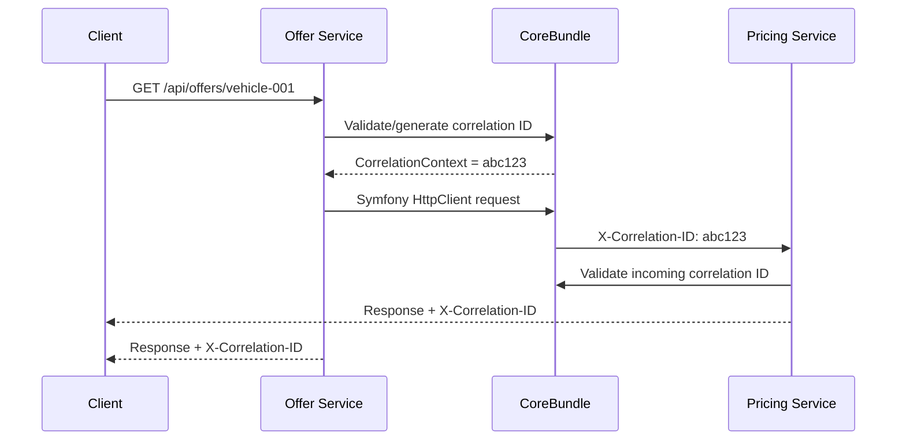

# 13 — Shared CoreBundle: cross-cutting platform capabilities

## 1. Decision and purpose

AutoFlow is a monorepo containing independently deployable Symfony applications. Repeating the same technical plumbing in every service creates drift, but sharing business models would couple bounded contexts and make independent evolution harder.

The accepted approach is a small Symfony bundle at `packages/core-bundle`, distributed locally through Composer path repositories in this monorepo.

**The CoreBundle is a technical foundation, not a shared domain.** It contains stable mechanics that are useful across multiple services. A service may opt into a capability; the bundle must not force every service to adopt every infrastructure technology.

## 2. Implemented in CoreBundle v2

- Symfony bundle class, DependencyInjection extension and validated configuration.
- Correlation ID context with incoming-header validation and safe generation.
- Response echo of `X-Correlation-ID`.
- Outgoing Symfony HttpClient propagation when a correlation ID exists.
- Liveness and readiness routes.
- Tagged readiness-check contract and result object.
- Messenger correlation stamp and middleware.
- Transport-neutral integration event envelope with event, aggregate, schema, correlation and causation metadata.
- RFC 9457-style Problem Details response factory.
- Composer integration in Offer and Pricing and Docker build support for the local package.
- Clean Architecture serialization port with JSON and Protobuf adapters.
- RoadRunner HTTP worker bridging PSR-7 requests to the Symfony HttpKernel.
- RoadRunner gRPC server runner and a shared `PlatformHealthService/Ping` smoke-test contract.
- HTTP/gRPC status mapping and scoped correlation-context restoration.
- Readiness now fails closed with HTTP 503 when no checks are registered; internal check details are not returned.
- Tests for correlation scope, JSON/Protobuf serialization, health behavior and protocol status mapping.

The existing `/health` endpoints remain unchanged because Compose health checks currently depend on them. The bundle adds `/health/live` and `/health/ready`. Both Offer and Pricing now run through RoadRunner with independent HTTP and gRPC listeners. The first gRPC method is a transport smoke check, not a business RPC.

## 3. Runtime request flow



OpenTelemetry remains responsible for trace/span context propagation through W3C Trace Context. The correlation ID is a separate operational identifier. They solve related but different diagnostic problems and must not be conflated.

## 4. HTTP and gRPC transport flow

RoadRunner owns the process lifecycle and exposes HTTP and gRPC listeners. The HTTP worker converts PSR-7 messages at the outer boundary and invokes the normal Symfony HttpKernel. The gRPC worker registers generated service interfaces and service-owned adapters. The shared `PlatformHealthService/Ping` method verifies gRPC transport startup.

The next service-specific step is to add versioned `.proto` contracts for Pricing and Offer business operations. Each gRPC adapter must map its Protobuf request to the same Application command/handler used by REST; it must not reimplement pricing or offer rules. Generated messages must never enter Domain code. Internal gRPC listeners are not intended to be public endpoints.

Application depends on `SerializerInterface`; Infrastructure provides JSON and Protobuf codecs. The Protobuf decoder requires an explicit generated message class and must never instantiate a class name taken from an untrusted payload.

## 5. Asynchronous message flow

The Messenger middleware attaches a `CorrelationIdStamp` when dispatching inside a correlated request. A worker restores that ID while handling the message and resets the previous context in a `finally` block. This prevents one message's context leaking into the next message in a long-running worker.

The middleware is provided but must be explicitly added to each Messenger bus. A service that does not use Messenger does not need to configure a bus.

The event envelope is a transport-neutral contract. It does not publish anything and does not implement the Transactional Outbox. The Outbox remains a service-owned persistence concern: business state and the outgoing event record must be committed atomically, then relayed with retry and idempotent consumption.

## 6. Health model

- `/health/live`: process/application liveness; no external dependency calls.
- `/health/ready`: aggregates registered `HealthCheckInterface` implementations.
- A failed check returns HTTP 503.
- No registered checks also returns HTTP 503 (fail closed).
- Public output includes only check names and status; internal details are not serialized.

No database, Redis, RabbitMQ or Elasticsearch check is registered by default. Each service must add only the checks for dependencies it truly requires to serve traffic. Checks should be bounded, read-only and avoid exposing infrastructure details.

## 7. Error contract

`ProblemDetailsFactory` creates an `application/problem+json` response. It is a helper for an HTTP adapter after the application error has been classified. The bundle does not globally catch all exceptions because that could hide programming errors or incorrectly map domain failures to HTTP responses.

A service should map known validation, not-found and conflict errors explicitly. Unexpected exceptions remain 500 responses and are logged with a correlation ID; internal details are never returned to clients.

## 8. Integration boundaries

| Concern | Owner |
| --- | --- |
| Correlation context and HTTP propagation | CoreBundle |
| OpenTelemetry SDK/exporter/collector configuration | Service deployment and shared observability infrastructure |
| Messenger middleware primitive | CoreBundle |
| Queues, exchanges, routing keys, retry and DLQ policy | Service/infrastructure configuration |
| Outbox table, repository and relay | Producing service |
| Event name and payload semantics | Publishing bounded context |
| Temporal workflow and Activities | Workflow-owning application |
| Vehicle, offer, pricing and contract domain models | Their respective bounded contexts |
| Authentication, authorization and tenant policy | Service/security boundary |

Temporal is not added as a CoreBundle dependency. A workflow's code, Activities, versioning and business state are owned by the service that owns the long-running process. Messenger and Temporal are complementary, not interchangeable: use Messenger for discrete asynchronous work and Temporal for durable orchestration across time, retries, timers and human/partner waits.

## 9. Composer and Docker packaging

Offer and Pricing each require `autoflow/core-bundle` through a Composer path repository. The service Docker build copies the package to `/packages/core-bundle` before dependency resolution. This is necessary because the Docker build context is the repository root while Composer runs from `/app`.

The path repository uses `symlink: false`; the bundle is copied into the service's vendor directory, so the runtime image does not depend on a host path. The service image copies the RoadRunner 3.0.1 binary and starts `rr serve` with its service-owned `.rr.yaml`. HTTP and gRPC use separate worker commands and pools.

When the package is published or the monorepo moves to versioned artifacts, replace the path repository with a tagged Composer repository and semantic version constraints. Keep the public package API backward-compatible within a major version.

## 10. Configuration

```yaml
core:
    correlation_id: true
    correlation_header: X-Correlation-ID
```

Messenger consumers opt in by adding `AutoFlow\\CoreBundle\\Messenger\\CorrelationIdMiddleware` to the bus middleware list.

## 11. Security and privacy

- Correlation IDs are validated and capped at 128 safe characters.
- Never use correlation IDs as authentication or authorization.
- Do not put customer identifiers, tokens, payment details or other personal data into IDs.
- Do not return exception internals in Problem Details.
- Do not expose health-check secrets or infrastructure connection strings.
- Do not put sensitive business data in event metadata or tracing attributes.
- Apply access control/network policy to operational endpoints according to deployment context.

## 12. Verification and next steps

The root PHPUnit suite includes tests for the context lifecycle, serializers, readiness behavior, gRPC smoke service and status mapping. CI validates Composer manifests, runs quality checks and builds both RoadRunner service images. End-to-end gRPC calls and business RPCs still require their service-specific contracts and tests.

Next increments:
1. Add service-owned Pricing and Offer `.proto` contracts with business adapters delegating to existing Application handlers.
2. Add a PHP gRPC client for internal Offer → Pricing calls, including deadlines, metadata propagation and safe status mapping; retain REST as an available interface.
3. Add end-to-end RoadRunner HTTP/gRPC integration tests and a test proving both transports invoke the same application handler.
4. Add functional tests for correlation propagation and Messenger context restoration.
5. Register real bounded-time readiness checks in each service.
6. Add safe structured logging, an Outbox and Temporal SDK integration only when concrete use cases require them.

Do not treat the presence of an interface or helper as proof that an end-to-end business workflow is deployed.
